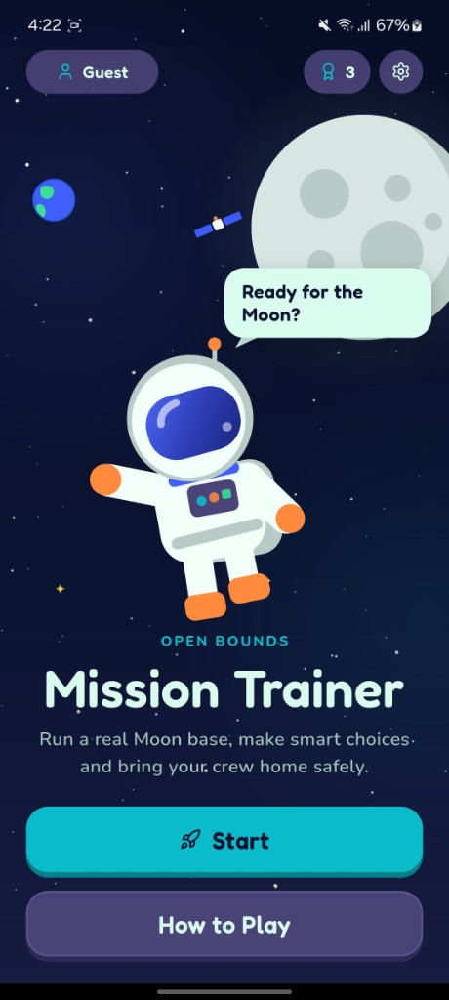
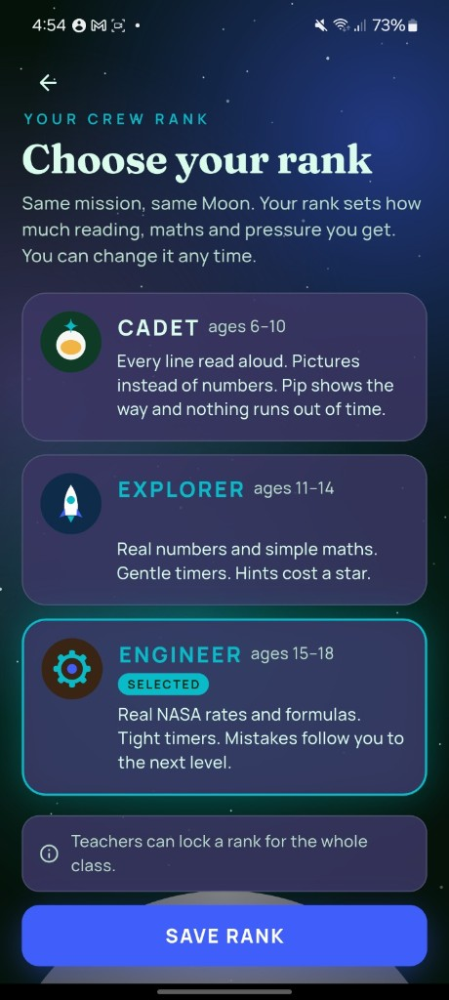
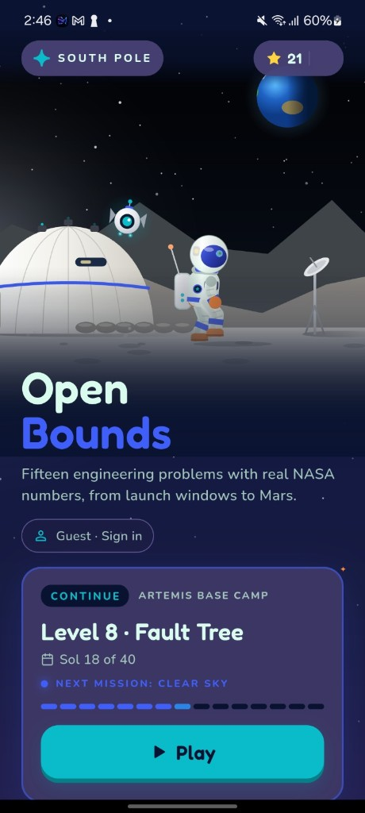
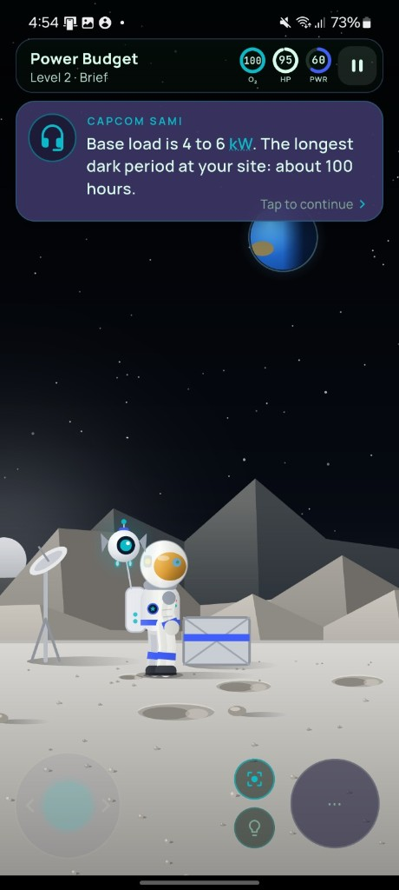

# Space Bounds — Junior Astronaut Mission Trainer

Walk Commander Nova across the Moon’s south pole, solve real engineering problems with real NASA numbers, and bring your crew home safely.

**Demo video:** [https://youtu.be/Ywzh4uJW13U](https://youtu.be/Ywzh4uJW13U?si=5e3egp4Fhohj9X4a)

Built for the **NASA Space Apps Challenge 2026** — *Build a Junior Astronaut Mission Trainer* (Beirut team).

---

## Play it

| | Link |
|---|---|
| **Play in the browser** | [https://basem-atiye.github.io/NASA-Space-App/](https://basem-atiye.github.io/NASA-Space-App/) |
| **Download Android APK** | [Space Bounds v2.0.0 (arm64)](https://github.com/Basem-Atiye/NASA-Space-App/releases/tag/v2.0.0) |

On a phone: open the release page → download **SpaceBounds-arm64-v2.0.0.apk** → allow install from that source → open the file.

---

## How to play

1. **Start** — Tap **Start** on the welcome screen (or **Play** on the home card) to begin a mission.
2. **Pick a difficulty (rank)** — Choose how hard the reading, maths, and timers feel:
   - **Cadet (6–10)** — every line read aloud, pictures, Pip helps, no timers
   - **Explorer (11–14)** — real numbers, gentle timers, hints cost a star
   - **Engineer (15–18)** — NASA rates and formulas, tight timers, mistakes carry forward  
   Teachers can lock a rank for a whole class.
3. **What you are trying to do** — Walk Nova on the lunar surface, talk to Mission Control, fix systems (power, air, leaks, dust…), and finish each level with good decisions. Stars and skills track how well you did. In **Base Commander**, keep oxygen, water, food, and power alive day by day until the mission ends.

---

## Screenshots

<p align="center">
  
  &nbsp;
  
</p>
<p align="center">
  
  &nbsp;
  
</p>

---

## Run from source

You need [Flutter](https://flutter.dev) **3.27.4+** (stable).

```bash
git clone https://github.com/Basem-Atiye/NASA-Space-App.git
cd NASA-Space-App
flutter pub get
flutter run
```

Useful variants:

```bash
flutter run -d chrome                          # browser
flutter run --release                          # phone / emulator
cp env/dev.example.json env/dev.json           # optional cloud keys (public only)
flutter run --dart-define-from-file=env/dev.json
```

Tests: `flutter test`

---

## Tools used

- **Flutter / Dart** — game client (Android, iOS, Web)
- **Figma** — Mission Trainer UI design
- **Supabase** — auth, Postgres, Realtime (classes, co-op, sync)
- **GitHub Actions + GitHub Pages** — web deploy
- **Audioplayers / flutter_tts / sensors_plus** — sound, read-aloud, tilt & motion

---

## NASA sources

Science numbers and scenarios draw on public NASA and mission data, including:

- Life support rates (NASA NTRS, e.g. 20040142395, 20100036823); ISS water recovery ~98% (NASA 2023)
- Lunar surface radiation (Chang’e 4 LND, *Science Advances*, 2020)
- Polar ice (LCROSS — Colaprete et al., *Science* 2010)
- Solar storms (NASA **DONKI**); moonquakes (Apollo Passive Seismic Experiment)
- Artemis / south-pole operations concepts for habitat, power, and surface ops

---

## Team

Beirut — NASA Space Apps Challenge 2026

- **Basem Atiye**
- **Ahmad El Haj**
- **Amal Nakuzi**
- **Maria Abo Shakra**
- **Reem Agha**
- **Marwa Al Hamedi**

---

## License notes

Fonts under the SIL Open Font License (`assets/fonts/`). Sounds made for this project.
